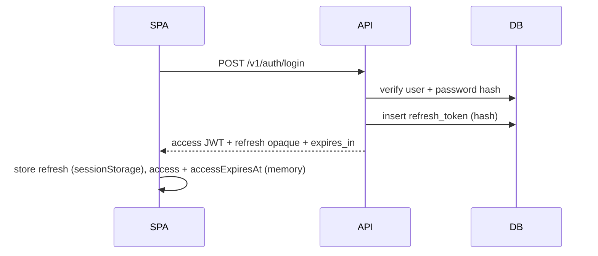
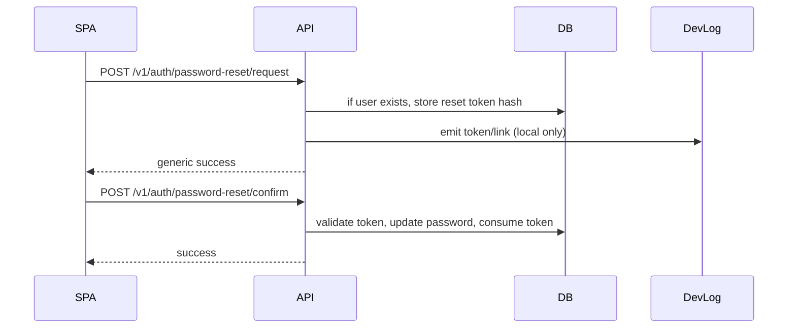

# Auth flows (Wave 1)

## Login



## Refresh

```mermaid
sequenceDiagram
  participant SPA
  participant API
  participant DB
  SPA->>API: POST /v1/auth/refresh { refresh_token }
  API->>DB: lookup hash, check expiry
  API-->>SPA: new access JWT (+ same refresh) + expires_in
  SPA->>SPA: update access + accessExpiresAt; reschedule proactive refresh
```

## Logout

```mermaid
sequenceDiagram
  participant SPA
  participant API
  participant DB
  SPA->>API: POST /v1/auth/logout { refresh_token }
  API->>DB: delete/revoke refresh row
  API-->>SPA: 204
  SPA->>SPA: clear tokens; cancel refresh timer; redirect / (F-008)
```

## Password reset (Wave 1)



## SPA bootstrap after reload (F-007)

```mermaid
sequenceDiagram
  participant SPA
  participant API
  SPA->>SPA: authStatus = loading
  SPA->>API: POST /v1/auth/refresh
  alt success
    API-->>SPA: new access + expires_in
    SPA->>API: GET /v1/users/me
    API-->>SPA: user
    SPA->>SPA: authStatus = authenticated
  else failure
    SPA->>SPA: clear refresh; authStatus = anonymous
  end
```

## SPA proactive refresh (F-007)

Before `accessExpiresAt` (target: **2 minutes** margin), the client calls refresh once. Optional: on `document.visibilitychange` to visible, refresh if access is near expiry.

## SPA authenticated fetch + 401 retry (F-007)

```mermaid
sequenceDiagram
  participant Page
  participant API
  Page->>API: request with Bearer access
  API-->>Page: 401
  Page->>API: POST /v1/auth/refresh (single mutex)
  alt refresh ok
    API-->>Page: new access
    Page->>API: retry original request
  else refresh fails
    Page->>Page: logout; navigate /login
  end
```

Public endpoints (login, register, reset) **must not** trigger this retry path.

## SPA token storage (Wave 1)

- **Access token:** in memory (React state/context); **`accessExpiresAt`** in memory.
- **Refresh token:** `sessionStorage` in current implementation; httpOnly cookie is Wave 3 hardening (see ADR-0003 follow-up).

Production cookie migration is Wave 3; F-007 applies to either transport.

## Related specs

- [F-007-spa-session-client.md](../features/F-007-spa-session-client.md)
- [F-008-spa-ui-polish.md](../features/F-008-spa-ui-polish.md)
