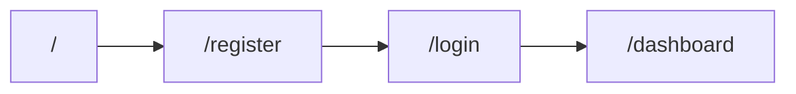

# User journeys — Wave 1

Mobile-first SPA + Identity API. Each journey links to feature specs and routes. Use this doc for **UX context**, **manual E2E**, and **bug narratives** (see [Reporting issues](#reporting-issues-bugs-and-intent)).

**Related:** [screens-mvp.md](screens-mvp.md) · [auth-flows.md](../security/auth-flows.md) · [frontend.md](../../docs/frontend.md)

---

## Story map (backbone)

| Discover | Register | Sign in | Use account | Security | Recover access |
|----------|----------|---------|-------------|----------|----------------|
| Landing `/` | F-001 | F-002, F-003, F-007 | F-004, Dashboard | F-005, F-008 logout | F-006 |

---

## Journey 1 — New user onboarding

**Actor:** Visitor  
**Goal:** Create an account and reach the dashboard  
**Specs:** [F-001](../features/F-001-registration.md), [F-002](../features/F-002-login-logout.md), [F-008](../features/F-008-spa-ui-polish.md) (post-login navigation)

| Step | User action | Screen / route | Expected outcome |
|------|-------------|----------------|------------------|
| 1.1 | Open app | `/` | Landing; options to sign in or register |
| 1.2 | Tap register | `/register` | Registration form |
| 1.3 | Submit valid details | `/register` | Success; directed to sign in (no verify email in Wave 1) |
| 1.4 | Sign in with new credentials | `/login` | Redirect to `/dashboard` |
| 1.5 | See welcome / email | `/dashboard` | Shows authenticated user summary |

**UX notes:** Password confirmation must match; duplicate email shows clear error (409).



---

## Journey 2 — Returning user (short session)

**Actor:** Registered user  
**Goal:** Sign in, view profile, sign out  
**Specs:** F-002, [F-004](../features/F-004-profile.md), F-008

| Step | User action | Screen / route | Expected outcome |
|------|-------------|----------------|------------------|
| 2.1 | Open app, sign in | `/login` → `/dashboard` | Dashboard with user info |
| 2.2 | Open profile | `/profile` | Form filled with current data |
| 2.3 | Edit fields, save | `/profile` | Success feedback; data persisted |
| 2.4 | Sign out | `/dashboard` or `/security` | Session cleared; land on `/` (F-008) |
| 2.5 | Try protected URL | `/dashboard` | Redirect to `/login` |

---

## Journey 3 — Long session (stay active > 15 minutes)

**Actor:** Signed-in user  
**Goal:** Keep working without unexpected logout  
**Specs:** [F-007](../features/F-007-spa-session-client.md), F-003

| Step | User action | Screen / route | Expected outcome |
|------|-------------|----------------|------------------|
| 3.1 | Sign in | `/login` | Tokens issued |
| 3.2 | Stay on app ≥ 20 min (e.g. profile) | `/profile` | Still authenticated; save profile works |
| 3.3 | Reload tab | any protected | Brief loading (F-007); then same user (refresh bootstrap) |

**F-007 implemented:** step 3.2 should pass after proactive refresh / 401 retry; use Journey 3 in manual E2E.

---

## Journey 4 — Forgot password (local dev)

**Actor:** User who forgot password  
**Goal:** Set a new password and sign in  
**Specs:** [F-006](../features/F-006-password-reset.md), ADR-0004

| Step | User action | Screen / route | Expected outcome |
|------|-------------|----------------|------------------|
| 4.1 | Request reset | `/forgot-password` | Generic success message (always) |
| 4.2 | Obtain link | API logs | `password_reset_dev_delivery url=.../reset-password?token=...` |
| 4.3 | Open link | `/reset-password?token=...` | New password form |
| 4.4 | Submit new password | `/reset-password` | Success; can sign in at `/login` |
| 4.5 | Sign in with new password | `/login` | Dashboard |

**UX notes:** User is told to check API logs in local dev ([screens-mvp.md](screens-mvp.md)).

---

## Journey 5 — Change password (signed in)

**Actor:** Authenticated user  
**Goal:** Replace password while logged in  
**Specs:** [F-005](../features/F-005-change-password.md)

| Step | User action | Screen / route | Expected outcome |
|------|-------------|----------------|------------------|
| 5.1 | Open security | `/security` | Change password form |
| 5.2 | Wrong current password | `/security` | Clear error; no change |
| 5.3 | Valid current + new password | `/security` | Success; can sign in with new password after logout |

---

## Manual E2E checklist (Wave 1 DoD)

- [ ] Journey 1 complete  
- [ ] Journey 2 complete  
- [ ] Journey 3 complete (or recorded as known gap pre–F-007)  
- [ ] Journey 4 complete (with log token)  
- [ ] Journey 5 complete  

---

## Reporting issues, bugs, and intent

When something goes wrong—or when you want a change—write a **short narrative** tied to a journey. That gives humans and AI the same context: **which story**, **which step**, **what you did in order**.

### Why narratives help

- Bugs are rarely “the button is broken”; they are **a path through the product**.  
- Numbered steps match this doc and manual E2E.  
- Expected vs actual maps directly to feature specs (F-00x).

### Template (copy into GitHub Issue, chat, or `specs/ux/reports/YYYY-MM-DD-slug.md`)

```markdown
## Report

**Type:** bug | ux-change | question  
**Journey:** (e.g. Journey 3 — Long session)  
**Step where it broke:** (e.g. 3.2)  
**Environment:** local docker | local uvicorn + npm | other  

### Steps I followed (numbered — the “story” I executed)

1. …
2. …
3. …

### Expected (from spec / journey table)

…

### Actual

…

### Evidence (optional)

- Screenshot / screen recording  
- Browser console (no secrets)  
- API log line (redact tokens)  
- Request: method + path only  

### Specs / routes involved

- F-00x: …  
- Route: …  

### Notes / what I want

…
```

### Example (pre–F-007)

```markdown
**Journey:** 3 — Long session  
**Step:** 3.2  

1. Signed in at /login as user@example.com  
2. Opened /profile  
3. Waited 18 minutes without reloading  
4. Changed phone number and tapped Save  

**Expected:** Profile saves; still signed in (F-007).  
**Actual:** Error "Invalid or expired token"; form did not save.  

**Specs:** F-007, F-004 — route /v1/users/me PATCH  
**Want:** Implement proactive refresh or 401 retry per F-007.
```

### Where to store reports (optional)

| Location | When to use |
|----------|-------------|
| **Chat / issue** | Quick; paste template |
| **`specs/ux/reports/`** | Keep history in repo (SDD trail) |
| **Link from journey step** | In reports, repeat journey + step IDs |

Do **not** paste refresh tokens, reset tokens, or JWTs into reports.

### UX change requests

Same template with **Type: ux-change** and **Notes / what I want** describing desired behavior. Reference journey step so scope stays clear (e.g. “After 1.3, auto-login instead of redirect to login” → product decision + update F-001/F-002 specs first).

---

## Adding new journeys (Wave 2+)

1. Add a row to the story map backbone.  
2. New section with steps table + spec links.  
3. Extend E2E checklist in [waves.md](../product/waves.md) if DoD changes.
